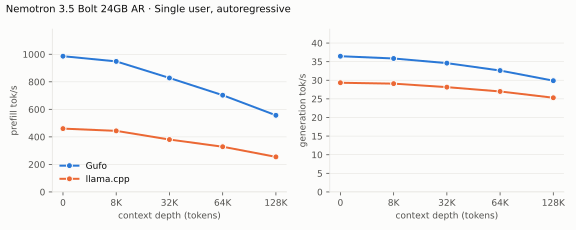
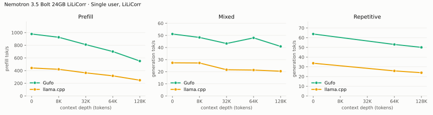

# Nemotron 3.5 Bolt benchmarks

AMD Strix Halo (`gfx1151`, Ryzen AI Max+ 395), 128 GB unified memory, OS
profile `performance`. The power mode was measured, not set: package power
averaged 86 to 87 W under load (peaks 118 W) with the GPU at about 2.35 GHz,
the 85 W mode; sustained rates are higher in the 140 W mode. NVIDIA's QAD
24 GB GGUF with its LiLiCorr drafter; both engines draft up to 7 tokens per
round. HTTP on both sides, greedy (temperature 0, seed 1), thinking off.
Extension 0.1.0 on Gufo `5f9612c3`, `release` build with ROCm 10.1;
llama.cpp build 12213 (`53eb66943`), Vulkan. Measured November 9, 2026, with
one sample per point after a warm-up.
Positive gain favors Gufo.
Quality and measurement details belong in [QUALITY.md](QUALITY.md).

## Single user, autoregressive

pp2048 / tg128; depth is the cached prefix in tokens.

<!-- bench:single-ar -->
| Nemotron 3.5 Bolt 24GB AR Depth (tokens) | Gufo pp (tok/s) | llama.cpp pp (tok/s) | Gain | Gufo tg (tok/s) | llama.cpp tg (tok/s) | Gain |
| ---: | ---: | ---: | ---: | ---: | ---: | ---: |
| 0 | 975.43 | 467.20 | +108.8% | 36.26 | 29.20 | +24.2% |
| 8,192 | 933.73 | 442.53 | +111.0% | 35.72 | 29.13 | +22.6% |
| 32,768 | 816.76 | 385.18 | +112.0% | 34.44 | 28.25 | +21.9% |
<!-- /bench -->

## Single user, LiLiCorr

Shared pp, separate mixed and repetitive tg and gains. pp is the highest
measured rate per engine and depth across both text types. Gufo drafts while
a request decodes alone; concurrent requests decode together in batches
without drafting.

<!-- bench:single-lilicorr -->
| Nemotron 3.5 Bolt 24GB LiLiCorr Depth (tokens) | Gufo pp (tok/s) | llama.cpp pp (tok/s) | Gain pp | Gufo tg mixed (tok/s) | llama.cpp tg mixed (tok/s) | Gain mixed | Gufo tg repetitive (tok/s) | llama.cpp tg repetitive (tok/s) | Gain repetitive |
| ---: | ---: | ---: | ---: | ---: | ---: | ---: | ---: | ---: | ---: |
| 0 | 999.28 | 445.32 | +124.4% | 41.41 | 26.68 | +55.2% | 53.48 | 34.73 | +54.0% |
| 8,192 | 922.49 | 424.30 | +117.4% | 42.01 | 30.04 | +39.8% | 51.36 | 33.92 | +51.4% |
| 32,768 | 806.67 | 368.47 | +118.9% | 33.23 | 22.06 | +50.6% | 47.95 | 31.78 | +50.9% |
<!-- /bench -->

